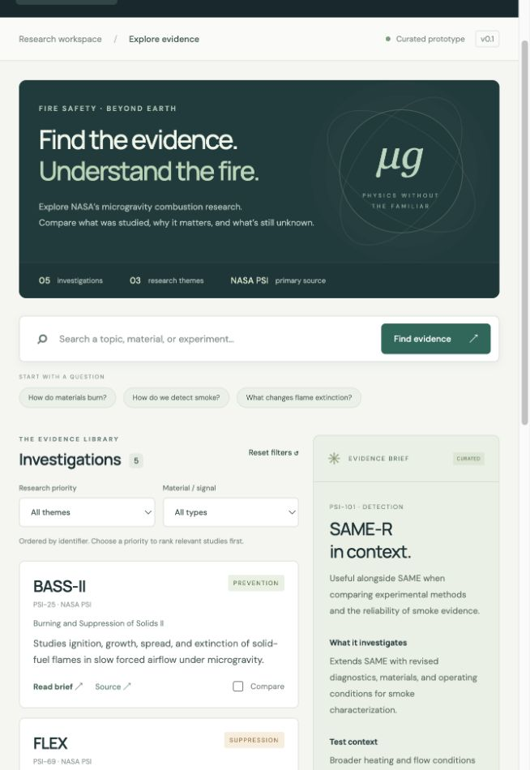

# 🔥 Ember Atlas — Microgravity Fire Safety Research Dashboard
> NASA Space Apps Challenge 2026: **Flame in Freefall**

Ember Atlas is an interactive, Super Intelligence (SI) powered dashboard that summarizes, ranks, and interprets NASA microgravity combustion research from the Physical Science Informatics (PSI) database to deliver critical fire safety insights for human space exploration.



---

## 🚀 Key Features

### 1. 🔍 Comprehensive Evidence Library (22 Investigations)
- Complete index of NASA microgravity combustion experiments across ISS racks (**CIR/ACME**, **CIR/MDCA**, **MSG**) and uncrewed orbital spacecraft (**Saffire I–III**).
- Covers **solid fuels**, **liquid droplets**, **gaseous diffusion flames**, and **smoke/aerosol dynamics**.
- Includes planned partial-gravity studies (**LUCI**, **FM2**) addressing the Moon (1/6g) and Mars (3/8g) data gaps.

### 2. 🤖 Grounded Super Intelligence (SI) Engine (Gemma 4 31B & Gemini Flash Lite)
- **Natural Language Research Assistant:** Ask deep scientific questions grounded strictly in NASA PSI data.
- **Strict Evidence Citation:** Every claim cites investigation IDs (e.g. `[PSI-25]`, `[PSI-98]`, `[PSI-102]`).
- **Claim Boundaries:** Clearly distinguishes between research hypotheses, experimental methods, observed results, and unknowns.
- **Intelligent Synthesis:** Auto-summarizes single studies or contrasts multi-study investigations using multi-model reasoning.

### 3. 📊 Interactive Experimental Data Explorer
- Real tabular test logs transcribed from NASA PSI (burn durations, initial/extinction droplet diameters, ambient pressures, flame spread rates).
- Interactive Recharts bar/trend visualizations colored by test endings (*Extinction*, *Disruption*, *Quenched*).
- One-click **CSV** and **JSON** data export.

### 4. ⚖️ Side-by-Side Study Comparison
- Compare up to 3 investigations across 8 scientific dimensions: objectives, fuel geometry, atmosphere/oxygen mole fraction, hardware insert, facility, diagnostics, and interpretation limits.
- One-click SI cross-examination highlighting complementary insights and divergent test protocols.

### 5. 🛡️ Mission-Specific Fire Safety Synthesis
- **Lunar Outposts & Pressurized Rovers:** Analyzes flammability risks in elevated oxygen (≥30% O₂ at 10.2 psi).
- **Orbital Spacecraft & Space Stations:** Examines ventilation-driven flame spread and large-scale solid burning.
- **Long-Duration Mars Missions:** Dust-tolerant smoke detection and suppressant logistics.
- **Terrestrial Spin-offs:** Fine-water-mist fire extinguishers, lightweight firefighter breathing apparatus (SCBA), and industrial particulate monitoring.

---

## 🛠️ Technology Stack

- **Frontend:** React 19, Vite 6, TailwindCSS v4, Recharts, Lucide React, React Router v7
- **Backend:** Node.js, Express 5, Better-SQLite3
- **Super Intelligence (SI) Engine:** Multi-model cascade (`gemma-4-31b-it` for deep reasoning, `gemini-3.5-flash-lite` and `gemini-3.1-flash-lite-preview` for rapid responses & fallback) via `@google/generative-ai`
- **Portability:** Dual-mode database (SQLite locally + zero-dependency in-memory dataset adapter for serverless runtimes)
- **Deployment:** Vercel ready (`vercel.json`, `api/index.js`), Railway/Docker/Node ready

---

## 💻 Quick Start (Run Locally)

### Prerequisites
- Node.js 18+ (tested on Node v22)
- A Google Gemini API key (already configured in `.env`, or get your own free at [aistudio.google.com](https://aistudio.google.com))

### 1. Install dependencies
```bash
npm install
```

### 2. Seed database
```bash
npm run seed
```

### 3. Start development servers
Runs the Express API on port `3001` and Vite client on port `5173` concurrently:
```bash
npm run dev
```
Open **[http://localhost:5173](http://localhost:5173)** in your browser!

### 4. Production standalone mode
```bash
npm run build
npm start
```
Open **[http://localhost:3001](http://localhost:3001)**.

---

